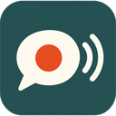

<p align="center"></p>

# Call Recorder: record Google Meet and web calls in Chrome, on your own computer

A free, open source **Chrome extension that records video calls** (Google Meet, [Konvene](https://github.com/rakeshmenon/konvene) and any call in a browser tab) to a single file on your own computer. It records the call, your microphone and the sound of a screen or tab you share, with noise reduction and small files.

**No server, no account, no upload, no telemetry.** Everything runs in your browser.

[Why](#why-use-it) · [Install](#install) · [FAQ](#faq) · [Design and plan](#design-and-plan) · [Licence](#licence)

## Why use it

- **Records the whole call.** The other people's voices and video, your microphone, and the sound of anything shared in the call, mixed into one MP4 or WebM file.
- **Clear voice.** RNNoise noise suppression runs on your computer, with a safety net that never lets it swallow your voice.
- **Private by design.** Nothing leaves your machine. No cloud, no sign-up, no analytics. Recording needs your click, and the extension makes recording visible to the others on the call.
- **Light.** The file is written to disk as it records, so memory stays flat on long meetings. Video is capped at 720p and 15 fps, and the encoder is chosen to go easy on your processor.
- **Free and open.** AGPL-3.0, built for Konvene and working on Google Meet and other web call sites.

## Install

Chrome Web Store: not published yet (see [store/SUBMIT.md](store/SUBMIT.md)). Until then, load it yourself:

```sh
git clone https://github.com/uditk2/call-recorder-extension
cd call-recorder-extension
npm install
npm run build
```

Then open `chrome://extensions`, switch on **Developer mode**, choose **Load unpacked** and pick the `dist/` folder. On first run, allow the microphone on the setup page.

## FAQ

**Can I record a Google Meet call in Chrome?** Yes. Open the call tab, click the extension, tick that you told everyone, and press Start. On Meet, the sound of a screen or tab you share is recorded too, while it is shared.

**Does it upload my recordings?** No. There is no server. Files go to `Downloads/Call Recordings`, or to a folder you choose.

**Does it work for Zoom, Teams or Slack calls?** Only the web versions in a Chrome tab. Desktop apps are not recorded.

**Is it legal to record a call?** In many places you need everyone's consent. The extension shows a recording badge on Konvene and asks you to confirm on other sites, but the responsibility is yours.

**Does it record my voice clearly?** Yes. Your microphone is cleaned with RNNoise, a small noise model that runs on your computer, and the audio is encoded at a bitrate that keeps speech clear.

## Design and plan

- [docs/design.md](docs/design.md): key points, sequence and data flow diagrams, permissions.
- [docs/implementation-plan.md](docs/implementation-plan.md): milestones, where things live, how it is tested, what a person still has to check.

## What it does

- When someone shares a screen or a tab in the call (Google Meet, Konvene), its sound is added to the recording automatically while it is shared, and drops out when sharing stops. No picker and nothing to remember. The call page hands a copy of the shared sound to the recorder over a local WebRTC connection inside the browser (`src/content/`, `src/recorder/webRtcShareReceiver.js`). A whole screen's sound replaces the call tab's own copy so the call is not doubled (`src/domain/shareKind.js`).
- Records the tab's video, the other people's voices and your microphone as one file (MP4 with H.264 when the machine has a hardware encoder, WebM with VP9 otherwise).
- Cleans your voice with RNNoise, which runs on your computer.
- Writes to disk as it records, so memory stays flat on long calls, and a crash leaves a recoverable file.
- Saves to `Downloads/Call Recordings` with no prompt, or to a folder you pick on the setup page.
- Live level meters in the popup show that your voice and the call are being heard. A warning appears if a recording had no sound, and the library repeats it.
- A safety net: if noise reduction ever swallows your voice, it is bypassed for the rest of that recording. It can also be switched off on the setup page.
- A library page lists recordings with time, length, size and the tab title.
- On Konvene, everyone sees a named recording badge. The extension will not start unless the page confirms the badge is showing. On Meet and other sites, the recorder must confirm they have told everyone.

## Commands

```sh
npm install
npm run check         # unit tests, store build, store validation
npm run build:dev     # dist-dev/, also trusts http://localhost:8790. Load this one while developing
npm run smoke         # loads dist-dev/ into a real Chromium and runs the whole engine with synthetic inputs
npm run package       # store zip in store/package/ (builds, validates, zips)
npm run store:assets  # screenshots, promo tile and privacy-policy.html in store/
```

To try it: open `chrome://extensions`, switch on Developer mode, choose **Load unpacked** and pick `dist-dev/` (or `dist/`).

## How the code is organised

```
src/domain/       rules with no browser code: types, ports (interfaces), codec choice, file names, site adapters
src/application/  the use cases: RecordingController, ExportService, repositories, output writers
src/recorder/     the engine that runs in the offscreen document: RecordingSession and its Web Audio, MediaRecorder and OPFS parts
src/infra/        Chrome adapters that implement the ports (tabs, downloads, offscreen, storage)
src/background/   service worker: the composition root, no decisions
src/ui/           popup, setup and library pages
src/content/      the Konvene bridge content script
src/shared/       typed messaging, formatting, the folder handle store
```

How the principles show up:

- **Single responsibility.** `CodecSelector` only chooses a codec. `RecordingSession` only orders the steps. `ExportService` only copies a finished file out. Each Chrome API has one small adapter.
- **Open for extension.** A new site is one adapter added to `domain/sites/defaultSites.js`. A new codec is one line in `CANDIDATES`. A new destination is a new `OutputWriter`. The recording code does not change for any of them.
- **Liskov.** Every `OutputWriter` and `SiteAdapter` can stand in for another. `FallbackOutputWriter` and `ConfiguredOutputWriter` are built from writers and are writers themselves.
- **Interface segregation.** Ports are small: `ChunkSink`, `Encoder`, `MixBuilder`, `TabMessenger`, `SavedFileGateway`. Nothing depends on methods it does not use.
- **Dependency inversion.** The controller and the session depend on interfaces. Only `background/serviceWorker.js` and `recorder/offscreenMain.js` name real classes.
- **DRY.** One message contract (`shared/api.js`), one config (`config.js`), one origin list shared by code and manifest, one export path used by Stop and by recovery, one site registry that the popup, the controller and the badge all use.

## What is tested

- 80 unit tests on the domain, application and recorder logic, with fakes for every port.
- `npm run smoke` in a real Chromium, including a human-like voice played in as the microphone with noise reduction on: the service worker answers, pages render in the brand fonts and colours, the Konvene bridge confirms (and refuses when the page stays silent), the offscreen engine starts, and the full engine records five seconds of synthetic video and sound to disk, reads it back mid-recording, and plays it.

## Lessons that are now tests

- A recording with video and no voice: RNNoise could not start inside the extension because Chrome's default policy blocks WebAssembly, and it fails silently. The manifest now allows `wasm-unsafe-eval` (the validator insists on it), and the smoke test records a voice. Tones had hidden the problem.
- A saved file named `.txt`: a file read from private storage has no type, and Chrome saves an untyped file as plain text. Files are now typed when handed over, and the smoke test checks it.
- Recordings that sounded swishy and not clear: the recording was AAC at 32 kbps (blocky holes above 3 kHz, nothing above about 9 kHz), and Chrome's own noise suppression ran on top of RNNoise, so speech was cleaned twice. AAC now gets 96 kbps and Opus 48 kbps, the browser's suppression is off whenever RNNoise is on, and the two compressors (which add automatic gain) are replaced by a fixed +3 dB and a soft clip that only touches peaks. Measured with `scripts/audio-quality.py` (PESQ and STOI against the clean voice).
- `npm run probe:audio` (with `SPEECH_WAV=tests/fixtures/voice.wav`) records the same voice several ways and prints how loud each second is, for the next time a recording sounds wrong.

## Not verified yet (needs a person with the real extension)

These cannot be driven by a script, because Chrome only allows them after a real click on the extension icon or with real hardware:

1. Real tab capture on a live call, including that the call stays audible to the user while recording.
2. Sharing a real screen and a real tab in real Google Meet: that the page hook sees the share, that `displaySurface` is reported, and that Meet's own page does not interfere. The smoke test covers the same path with a stand-in call page.
3. Real microphone and echo on speakers (browser echo cancellation should remove the other side from the mic).
4. The H.264 hardware path and AAC audio inside MP4, and that a crash still leaves a playable MP4. The test machine had no hardware H.264, so only the WebM path ran.
5. A chosen output folder: Chrome may ask to allow it again in a new browser session. The code falls back to Downloads, but the prompt flow is untested.
6. A very long recording (an hour) while the service worker saves it. A keep-alive is in place, but it is untested at that length.
7. The Konvene badge inside Konvene's own end-to-end test. The bridge is tested against a stand-in page.

## The Konvene side

The Konvene side of this (the page shows the named recording badge and confirms it before the extension records) lives in Konvene itself: `src/main.js`, `public/privacy.html`, `CHANGELOG.md`.
Without it the extension refuses to record on Konvene.

## Known limits

- Only Konvene's public address is trusted by the bridge. A self-hosted Konvene needs its address added to `src/domain/sites/konveneOrigins.json`.
- One recording at a time.
- Per-voice channels are not built, by decision.
- Licensed under AGPL-3.0, like Konvene. Fonts and RNNoise notices are in `THIRD_PARTY_NOTICES.txt`.

See `store/SUBMIT.md` for putting it on the Chrome Web Store.

## Licence

AGPL-3.0, the same as [Konvene](https://github.com/rakeshmenon/konvene). See `LICENSE`. This extension is also proposed for Konvene itself under `extensions/call-recorder`.
