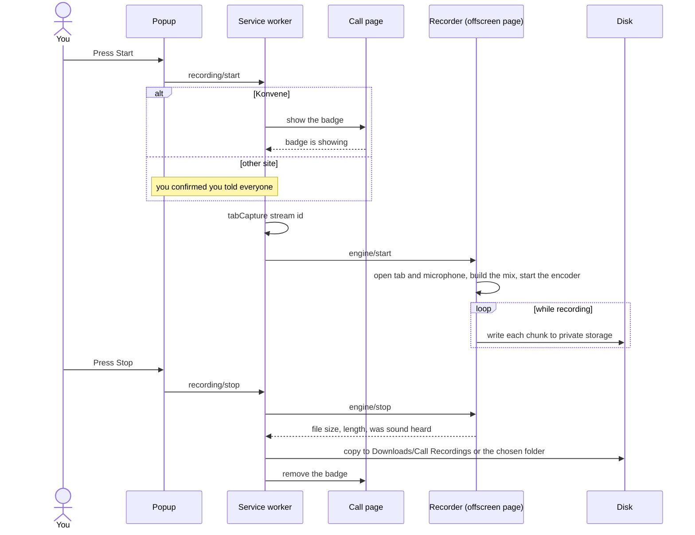
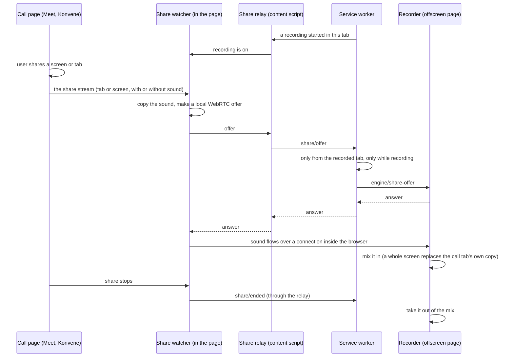
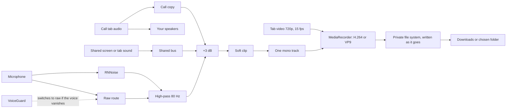

# Call recorder: design

A Chrome extension that records a call tab, your microphone and anything you share in the call, to a file on your own computer. No server, no account, nothing uploaded. Built for Konvene first, and works on Google Meet and any other call tab.

## Key points

- **Your computer does the work.** Recording, noise reduction, compression and saving all run in your browser. Nothing leaves the machine.
- **One tab, one microphone, one file.** Chrome's tab capture gives the video and the call audio of the tab. The microphone comes from `getUserMedia`. Both are mixed into one mono track with the tab's picture.
- **Clear voice.** RNNoise (a small noise model, running in an audio worklet) cleans the microphone. A safety check (`VoiceGuard`) switches it off if it ever swallows your voice, so a recording is never silent because of it.
- **Small files.** MP4 with H.264 when the machine has a hardware encoder, WebM with VP9 otherwise. 720p at 15 fps, Opus or AAC audio at 48 or 96 kbps.
- **Safe on long calls.** The encoder's output is written to the browser's private file system as it arrives, so memory stays flat and a crash leaves a playable file. On Stop it is copied to Downloads/Call Recordings, or to a folder you chose in setup.
- **Recording is visible.** On Konvene the page shows everyone a named badge, and the extension refuses to start until the page confirms it is showing. On other sites you confirm that you told everyone.
- **Shared screens and tabs are recorded too.** When someone shares a screen or tab in the call, its sound is added while it is shared and drops out when sharing stops. No picker, nothing to remember.
- **Few permissions.** `tabCapture`, `offscreen`, `activeTab`, `downloads`, `storage`, and page scripts on `meet.google.com` and Konvene only.

## Pieces

```
src/domain/       rules with no browser in them: codec choice, file names, site rules, share rules, VoiceGuard
src/application/  the use cases: start, stop, recover, list, remove, accept a share
src/recorder/     the engine that runs in the offscreen page: inputs, mix, encoder, file writer, share receiver
src/infra/        thin Chrome adapters: tabs, downloads, storage, the offscreen page
src/background/   the service worker: builds the real objects and answers messages
src/content/      scripts on the call page: the Konvene badge bridge, the share relay, the share watcher
src/ui/           popup, setup page, library page
src/shared/       the typed message contract and small helpers
```

The application layer and the recording session depend on small interfaces (ports), written down in `src/domain/ports.js` and `src/recorder/ports.js`. Two files name real classes (`background/serviceWorker.js`, `recorder/offscreenMain.js`). Everything else can be faked, which is how the unit tests run without a browser.

- **Add a site:** one adapter in `domain/sites/defaultSites.js`.
- **Add a codec:** one line in `CANDIDATES` in `domain/codecSelector.js`.
- **Add a destination for the file:** one `OutputWriter`.

## Recording: sequence



## Shared screen or tab: sequence

Only the call page can see what it shares, so a small script runs inside it and watches for the page asking Chrome for a share.



A share without sound is ignored. If the recording is not running, or the offer comes from another tab, the answer is "not recorded" and the page lets go of the connection.

## Audio: data flow



- **Call copy:** the call tab's sound as recorded. It steps aside when a whole screen's sound is shared, because that sound already holds the call and two copies a few milliseconds apart would echo.
- **No compressor.** A Web Audio compressor adds automatic gain that lifts background noise and makes it pump. A soft clip only rounds off the loudest peaks.

## Privacy and permissions

| Permission | Why |
|---|---|
| `tabCapture` | Record the tab you start the recording on |
| `offscreen` | Keep recording after the popup closes |
| `activeTab` | Read the tab's title and address when you click the icon, to name the file |
| `downloads` | Save the file, show it in its folder, delete it from the library |
| `storage` | The library list and settings, kept in the browser on your computer |
| Page scripts on `meet.google.com` and Konvene | Notice a shared screen or tab and hand its sound to the recorder. They run only while a recording is running in that tab, read no text or messages, and send nothing over the network |

The extension makes no network requests. `npm run validate` fails the build if a permission is added without a written reason in `store/permissions.md`.

## What it cannot do

- Record sound that is not shared in the call (a notification, a video in another window).
- Start a recording by itself. Chrome only allows tab capture after you click the extension.
- Record other browsers or desktop call apps.

See [implementation-plan.md](implementation-plan.md) for what is done and what is left.
